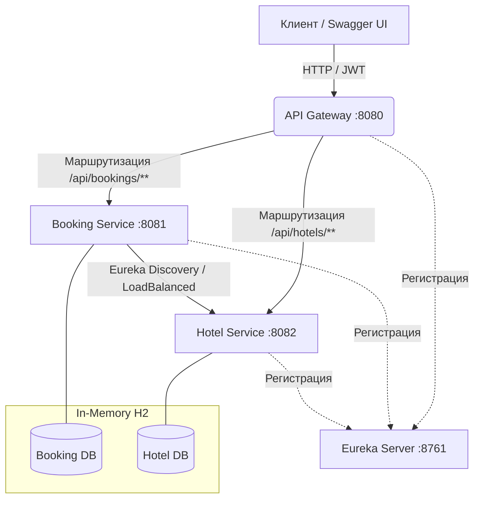

# Итоговый проект: Микросервисное API-приложение бронирование отелей

Проект по дисциплине «Фреймворк Spring и работа с REST API».
Представляет собой систему бронирования отелей, реализованную на базе микросервисной архитектуры с использованием Spring Cloud, паттерна Сага и JWT-авторизации.

## 🏗 Архитектура системы

Проект состоит из 4 независимых Spring Boot приложений:

### Технологический стек
* **Java 21**
* **Spring Boot 3.3.5**, **Spring Cloud 2023.0.3**
* **Spring Security + OAuth2 Resource Server** (JWT)
* **Spring Cloud Gateway** (API Gateway)
* **Spring Cloud Eureka** (Service Discovery)
* **Spring Data JPA + H2** (In-memory)
* **Resilience4j** (Retry, CircuitBreaker, TimeLimiter)
* **MapStruct**, **Lombok**
* **Springdoc OpenAPI** (Swagger UI)
* **Logback + Logstash Encoder** (JSON логирование с MDC)

---

## 🚀 Запуск проекта

Для проверки потребуется запустить 4 приложения в следующем порядке (в IntelliJ IDEA):

1. **Eureka Server** (`eureka-server`) - http://localhost:8761
2. **Hotel Service** (`hotel-service`) - http://localhost:8082
3. **Booking Service** (`booking-service`) - http://localhost:8081
4. **API Gateway** (`api-gateway`) - http://localhost:8080

*Примечание: В сервисах предзаполнены тестовые данные (профиль `demo`).*
*Пользователи: `admin/admin` (роль ADMIN), `user/user` (роль USER).*

**Единая точка входа (Swagger через Gateway):** http://localhost:8080/webjars/swagger-ui/index.html

---

## 🔐 Безопасность (JWT)
* Время жизни токена: 1 час.
* Каждый сервис (Booking и Hotel) является Resource Server и проверяет JWT самостоятельно.
* Роли: `USER` (личные операции, бронирование) и `ADMIN` (управление отелями, номерами, пользователями).
* Токен передается в заголовке `Authorization: Bearer <token>`.

---

## 🛠 Основные эндпойнты

### Booking Service (через Gateway `/api/...`)
| Метод | Эндпойнт | Роль | Описание |
|---|---|---|---|
| POST | `/user/register` | All | Регистрация пользователя |
| POST | `/user/auth` | All | Авторизация (выдача JWT) |
| GET | `/user` | ADMIN | Список всех пользователей |
| DELETE | `/user/{id}` | ADMIN | Удалить пользователя |
| POST | `/booking` | USER | Создать бронирование (требует `Idempotency-Key`) |
| GET | `/bookings` | USER | История своих бронирований (с пагинацией) |
| GET | `/booking/{id}` | USER | Получить конкретное бронирование |
| DELETE | `/booking/{id}` | USER | Отменить бронирование |

### Hotel Service (через Gateway `/api/...`)
| Метод | Эндпойнт | Роль | Описание |
|---|---|---|---|
| GET | `/api/hotels` | USER | Список отелей |
| POST | `/api/hotels` | ADMIN | Добавить отель |
| GET | `/api/rooms` | USER | Все доступные номера |
| GET | `/api/rooms/recommend` | USER | Рекомендованные номера (сортировка по `times_booked`) |
| POST | `/api/rooms` | ADMIN | Добавить номер |
| POST | `/api/rooms/{id}/confirm-availability` | INTERNAL | Подтвердить бронь (блокировка) |
| POST | `/api/rooms/{id}/release` | INTERNAL | Отменить бронь (компенсация) |

---

## ⚙️ Ключевые особенности реализации

### 1. Сага (Распределенная транзакция)
При создании бронирования Booking Service выполняет следующие шаги:
1. Создает бронирование в статусе `PENDING`.
2. Вызывает Hotel Service по эндпойнту `confirm-availability`.
3. Если ответ успешный: статус меняется на `CONFIRMED`.
4. Если произошла ошибка/таймаут: статус меняется на `CANCELLED`, и вызывается компенсация `release` (снятие блокировки).

### 2. Идемпотентность
Для предотвращения создания дубликатов при повторных запросах используется заголовок `Idempotency-Key`.
Результат первого запроса сохраняется в БД (таблица `processed_requests`). При повторном запросе с тем же ключом возвращается закэшированный ответ без вызова Hotel Service.

### 3. Защита от гонок (Concurrency)
При подтверждении доступности номера используется **Pessimistic Lock** (`SELECT ... FOR UPDATE`) на сущность `Room`. Это гарантирует, что параллельные запросы на одни и те же даты не создадут дубликатов, а вернут `409 Conflict`.
Дополнительно в таблице `room_slots` стоит `UniqueConstraint` на `(room_id, start_date, end_date)`.

---

## 🧪 Тестирование
В проекте реализованы интеграционные тесты с использованием `MockMvc` и `H2` (профиль `test`).
Покрыты сценарии:
* Успешная Сага (`PENDING -> CONFIRMED`)
* Ошибка отеля и компенсация (`PENDING -> CANCELLED`)
* Идемпотентность (повторный запрос)
* Конфликт бронирования (409)
* Ошибки валидации (400)
* Проверка ролей (403)

Для запуска тестов: `mvn test`

---

## 📝 Architecture Decision Records (ADR)

### ADR-1: Использование ручной Саги вместо фреймворка (Axon/StateMachine)
* **Контекст:** Необходимо обеспечить согласованность данных между Booking и Hotel Service.
* **Решение:** Реализована ручная оркестрация Саги (try-catch с вызовом компенсации `release`).
* **Альтернативы:** Axon Framework, Spring StateMachine.
* **Последствия:** Ручная сага проще для понимания в рамках учебного проекта, не требует подключения тяжелых фреймворков и дает полный контроль над логикой. Минус: при усложнении бизнес-логики код может стать сложным для поддержки.

### ADR-2: Использование Pessimistic Lock вместо Optimistic Lock
* **Контекст:** Защита от параллельных бронирований одного номера на одни и те же даты.
* **Решение:** При вызове `confirm-availability` используется блокировка `LockModeType.PESSIMISTIC_WRITE`.
* **Альтернативы:** Optimistic Lock (через `@Version`).
* **Последствия:** Pessimistic Lock в данном случае надежнее, так как бронирования номеров на одни и те же даты происходят часто, и мы хотим сразу вернуть `409 Conflict` клиенту, а не заставлять его делать Retry при `OptimisticLockException`.

### ADR-3: Общий модуль `common`
* **Контекст:** Классы `ErrorDTO`, `JwtService` и `TraceIdFilter` дублируются в разных сервисах.
* **Решение:** Создан Maven-модуль `common`, который подключается как зависимость.
* **Последствия:** Соблюдается принцип DRY. Единый формат ошибок и логики JWT. Минус: при изменении `common` требуется пересборка всех микросервисов (в отличие от независимого развития).

### ADR-4: Использование заголовка `Idempotency-Key`
* **Контекст:** Сетевые сбои и таймауты могут привести к тому, что клиент отправит один и тот же запрос дважды.
* **Решение:** Клиент передает уникальный `Idempotency-Key`. Сервер сохраняет ответ в БД (`processed_requests`) и при повторе отдает его без повторной бизнес-логики.
* **Альтернативы:** Естественная идемпотентность (например, проверка по хэшу параметров).
* **Последствия:** Надежный механизм, защищающий от двойного списания средств/двойного бронирования.

---

## 📊 Чек-лист по критериям оценивания

| Критерий | Где реализовано | Как проверить |
|---|---|---|
| **1. Алгоритм планирования** | Hotel Service (`RoomRepository`, `recommend`) | GET `/api/rooms/recommend` (сортировка) |
| **2. Сага и устойчивость** | Booking Service (`BookingServiceImpl`, `HotelClient`) | Падение Hotel Service при создании брони (статус CANCELLED) |
| **3. CRUD бронирований** | Booking Service (`BookingController`) | Swagger: POST/GET/DELETE `/booking`, пагинация |
| **4. CRUD отелей и номеров** | Hotel Service (`HotelController`, `RoomController`) | Swagger: POST/GET `/api/hotels` |
| **5. Gateway + Eureka** | `api-gateway`, `eureka-server` | Запросы через порт 8080, дашборд Eureka |
| **6. Безопасность (JWT)** | Все сервисы (`SecurityConfig`, `@PreAuthorize`) | 401 без токена, 403 для USER на админских методах |
| **7. Тестирование** | `src/test/java` в обоих сервисах | `mvn test` (7 тестов) |
| **8. Структура БД** | `entity` в Booking и Hotel | Таблицы `users`, `bookings`, `hotels`, `rooms`, `room_slots` |
| **9. Предзаполнение данных** | `DemoDataLoader` в обоих сервисах | Профиль `demo` при старте создает данные |
| **10. Качество кода (SOLID, DRY)** | Архитектура, модуль `common` | Разделение на слои (Controller/Service/Repo), вынос общего кода |
| **11. Код-стиль** | Весь проект | Читаемые имена, структура пакетов |
| **12. Обработка ошибок** | `GlobalExceptionHandler`, `HotelExceptionHandler` | Единый `ErrorDTO` при 400, 403, 409, 500 |
| **13. Логирование** | `logback-spring.xml`, MDC | JSON-логи с `traceId` и `bookingId` в консоли |
| **14. Документация** | `README.md` | Этот файл (инструкция, Mermaid, ADR) |
| **15. Поддерживаемость тестов** | Тесты | Использование `@Nested`, `@DisplayName`, Mockito |